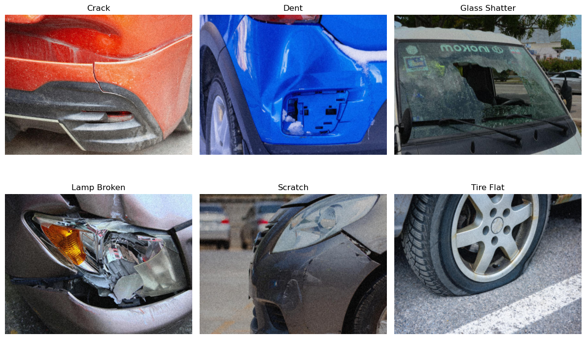
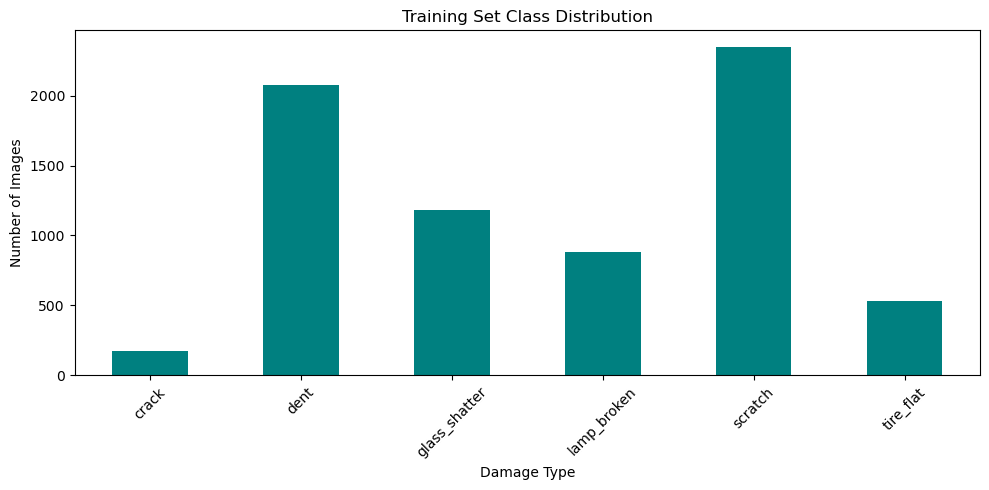
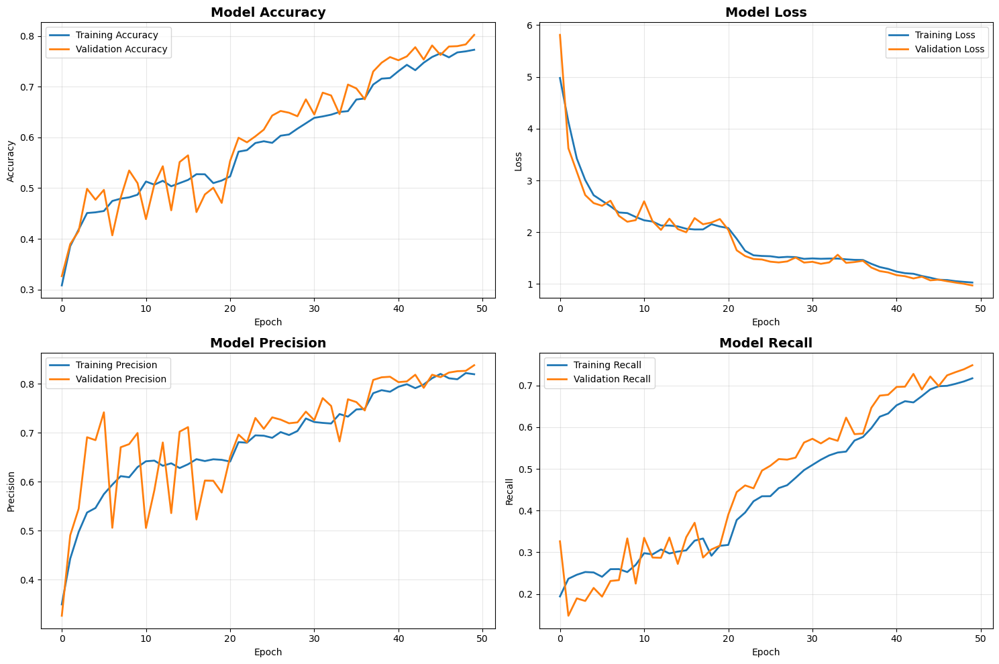
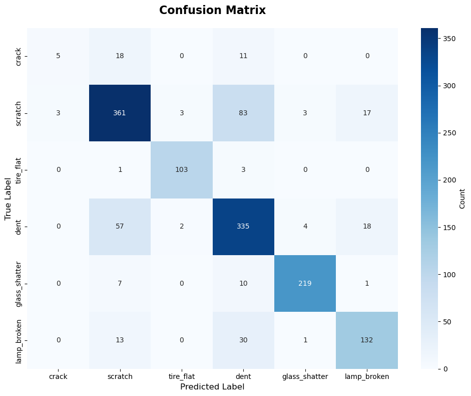
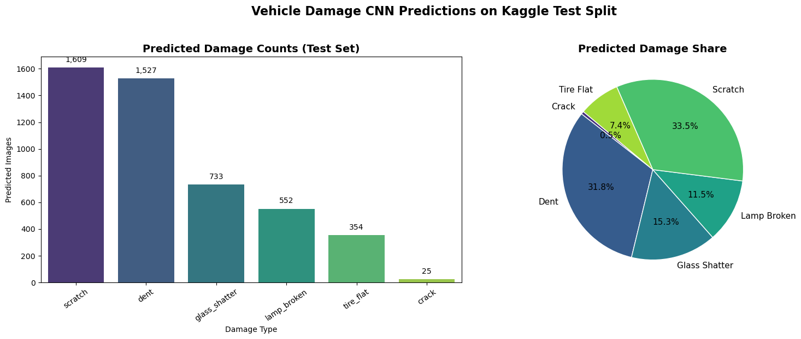

# Vehicle Damage Classification with a CNN

**Insurance claim verification: classifying vehicle damage from images**

A convolutional neural network built from scratch in TensorFlow/Keras that classifies photos of damaged vehicles into six damage types. The project covers the full workflow: data preparation, augmentation, architecture design, regularisation, training with adaptive callbacks, evaluation, overfitting analysis and inference on an unlabelled test set.



---

## Table of Contents

- [Results](#results)
- [Dataset](#dataset)
- [Model Architecture](#model-architecture)
- [Training Setup](#training-setup)
- [Evaluation](#evaluation)
- [Test Set Inference](#test-set-inference)
- [Getting Started](#getting-started)
- [Repository Structure](#repository-structure)
- [Limitations](#limitations)
- [Future Work](#future-work)
- [Tech Stack](#tech-stack)

---

## Results

Evaluated on a stratified 20% validation split (1,440 images):

| Metric | Score |
|---|---|
| **Accuracy** | **80.2%** |
| Weighted F1 | 0.798 |
| Macro F1 | 0.740 |
| Weighted precision | 0.803 |
| Weighted recall | 0.802 |

| Class | Precision | Recall | F1 | Support |
|---|---|---|---|---|
| crack | 0.625 | 0.147 | 0.238 | 34 |
| scratch | 0.790 | 0.768 | 0.779 | 470 |
| tire_flat | 0.954 | 0.963 | **0.958** | 107 |
| dent | 0.710 | 0.805 | 0.755 | 416 |
| glass_shatter | 0.965 | 0.924 | 0.944 | 237 |
| lamp_broken | 0.786 | 0.750 | 0.767 | 176 |

- **Tire flat and glass shatter** are recognised very reliably (F1 > 0.94); both have distinctive visual signatures.
- **Scratch and dent** are most often confused with each other (83 scratches predicted as dents, 57 dents as scratches).
- **Crack** is the weak spot: with only 171 training images (2.4% of the data), recall is 0.15.
- **No overfitting:** final training accuracy is 77.3% vs 80.2% on validation (gap −2.9 points), and validation loss sits below training loss.

---

## Dataset

- **Source:** [Ripik Hackfest: Vehicle Damage (Kaggle)](https://www.kaggle.com/datasets/sudhanshu2198/ripik-hackfest)
- **Training images:** 7,200 labelled images (split 80/20 into 5,760 train / 1,440 validation, stratified, `random_state=42`)
- **Test images:** 4,800 unlabelled images (labels withheld by the competition)

| Label | Class | Images | Share |
|---|---|---|---|
| 1 | crack | 171 | 2.4% |
| 2 | scratch | 2,349 | 32.6% |
| 3 | tire_flat | 534 | 7.4% |
| 4 | dent | 2,079 | 28.9% |
| 5 | glass_shatter | 1,185 | 16.5% |
| 6 | lamp_broken | 882 | 12.3% |



The dataset is heavily imbalanced: there are 14× as many scratch images as crack images.

> The images are **not included** in this repository. See [Getting Started](#getting-started) for where to put them.

---

## Model Architecture

A custom CNN with four convolutional blocks and a two-layer dense head, **26.4M parameters** in total.

```
Input (224 × 224 × 3)
│
├─ Block 1: Conv2D(32, 3×3) → BN → Conv2D(32, 3×3) → BN → MaxPool(2×2) → Dropout(0.25)
├─ Block 2: Conv2D(64, 3×3) → BN → Conv2D(64, 3×3) → BN → MaxPool(2×2) → Dropout(0.25)
├─ Block 3: Conv2D(128, 3×3) → BN → Conv2D(128, 3×3) → BN → MaxPool(2×2) → Dropout(0.25)
├─ Block 4: Conv2D(256, 3×3) → BN → MaxPool(2×2) → Dropout(0.25)
│
├─ Flatten
├─ Dense(512, ReLU) → BN → Dropout(0.5)
├─ Dense(256, ReLU) → BN → Dropout(0.5)
└─ Dense(6, Softmax)
```

| Design choice | Reason |
|---|---|
| Filters doubling 32 → 64 → 128 → 256 | Learn a hierarchy from edges and textures up to damage-specific shapes |
| Stacked 3×3 kernels, `padding='same'` | Large receptive field with few parameters; preserves spatial alignment |
| ReLU activations | Efficient and avoids vanishing gradients |
| Batch normalisation after each layer | Stabilises training and allows higher learning rates |
| Softmax output | Probability distribution over the six classes |

### Regularisation

| Technique | Setting | Purpose |
|---|---|---|
| L2 weight decay | λ = 0.001 on every Conv2D and hidden Dense layer | Penalises large weights |
| Dropout | 0.25 in conv blocks, 0.5 in dense head | Prevents co-adaptation of neurons |
| Batch normalisation | After every Conv2D and hidden Dense layer | Stabilises activations |
| Data augmentation | See below | Adds viewpoint diversity, especially for rare classes |
| Early stopping | Monitor `val_loss`, patience 10, restore best weights | Stops training before overfitting |

**Data augmentation (training only):** rescale to [0, 1], rotation ±20°, width/height shift 20%, horizontal flip, zoom 20%, shear 20%, `fill_mode='nearest'`. Validation and test images are only rescaled.

---

## Training Setup

| Hyperparameter | Value |
|---|---|
| Input size | 224 × 224 RGB |
| Batch size | 32 (180 steps per epoch) |
| Optimiser | Adam |
| Initial learning rate | 0.001 |
| Loss | Categorical cross-entropy |
| Metrics tracked | Accuracy, precision, recall |
| Max epochs | 50 |
| LR schedule | `ReduceLROnPlateau` on `val_loss`: factor 0.2, patience 5, min 1e-7 |
| Seed | 42 (NumPy and TensorFlow) |

**What happened during training:**
- The learning rate was reduced twice: to 2e-4 at epoch 21 and to 4e-5 at epoch 37. Each drop gave a clear jump in validation accuracy.
- Early stopping never triggered. The best epoch was the **last one (50)**, and both curves were still improving, so the model would likely benefit from more epochs.
- Training took roughly **20 hours** in total (an average of ~24 minutes per epoch on the original machine).



---

## Evaluation

### Confusion matrix



The main errors are:
- **Scratch ↔ dent:** visually similar surface damage, and also the two largest classes
- **Crack → scratch / dent:** 29 of 34 cracks are misclassified, mostly as scratches
- **Lamp broken → dent:** 30 cases, likely where front-end damage affects both

### Overfitting analysis

| | Training | Validation | Gap |
|---|---|---|---|
| Accuracy | 0.7727 | 0.8021 | −0.0293 |
| Loss | 1.0284 | 0.9727 | −0.0556 |

Validation scores beat training scores because dropout and heavy augmentation are active during training but switched off at evaluation time. The small, negative gaps show the regularisation strategy is working and the model is **not overfitting**. If anything, it is slightly underfit.

---

## Test Set Inference

The trained model predicts labels for the 4,800 unlabelled Kaggle test images and saves them to `vehicle_damage_test_predictions.csv` (columns: `filename`, `predicted_label`, `predicted_label_name`).

| Predicted class | Images | Share |
|---|---|---|
| scratch | 1,609 | 33.5% |
| dent | 1,527 | 31.8% |
| glass_shatter | 733 | 15.3% |
| lamp_broken | 552 | 11.5% |
| tire_flat | 354 | 7.4% |
| crack | 25 | 0.5% |

The predicted mix closely matches the training distribution. Crack is still under-predicted (0.5% vs 2.4% in training), consistent with its low validation recall.



---

## Getting Started

### Requirements

- Python 3.10–3.12
- A GPU is strongly recommended (the original 50-epoch run took ~20 hours)

### Installation

```bash
# 1. Clone the repository
git clone https://github.com/GracieDataDiary/vehicle-damage-classification-cnn.git
cd vehicle-damage-classification-cnn

# 2. Create and activate a virtual environment
python -m venv venv
source venv/bin/activate          # Windows: venv\Scripts\activate

# 3. Install dependencies
pip install -r requirements.txt
```

### Add the dataset

Download the dataset from [Kaggle](https://www.kaggle.com/datasets/sudhanshu2198/ripik-hackfest) and extract it so the folder looks like this:

```
datasets/vehicle_damage/
├── train/
│   └── train/
│       ├── images/        # 7,200 labelled images (1.jpg … 7200.jpg)
│       └── train.csv      # image_id, filename, label (1–6)
└── test/
    └── test/
        ├── images/        # 4,800 unlabelled images
        └── test.csv       # filenames only
```

### Run

```bash
jupyter notebook Component_Two_Vehicle_Damage_CNN.ipynb
```

Run all cells from top to bottom. The notebook stops early with a clear error if the dataset is missing. Training saves the model to `vehicle_damage_cnn.h5`.

> **Tip:** to check the pipeline quickly before a full run, change `epochs=50` to `epochs=2` in the training cell.

---

## Repository Structure

```
.
├── Component_Two_Vehicle_Damage_CNN.ipynb   # full pipeline and written analysis
├── images/                                  # charts produced by the notebook
│   ├── vehicle_damage_samples.png
│   ├── vehicle_damage_class_distribution.png
│   ├── training_history.png
│   ├── confusion_matrix.png
│   └── test_prediction_distribution.png
├── requirements.txt
├── .gitignore
└── README.md

# Created locally, not tracked by git:
├── datasets/                                # Kaggle images (download)
├── vehicle_damage_cnn.h5                    # trained model (too large for git)
├── vehicle_damage_test_predictions.csv      # test predictions
└── *.png                                    # charts saved by each run
```

### Code structure

All model logic is wrapped in a `VehicleDamageCNN` class:

| Method | Purpose |
|---|---|
| `create_data_generators()` | Builds augmented training and plain validation generators from dataframes |
| `build_cnn_model()` | Defines the architecture (dropout rate and L2 strength are configurable) |
| `compile_model()` | Adam optimiser, categorical cross-entropy, accuracy/precision/recall |
| `train_model()` | Trains with EarlyStopping and ReduceLROnPlateau |
| `evaluate_model()` | Returns the classification report and confusion matrix |
| `plot_training_history()` | Plots accuracy, loss, precision and recall curves |
| `plot_confusion_matrix()` | Plots a labelled confusion matrix heatmap |
| `check_overfitting()` | Reports train/validation accuracy and loss gaps |

---

## Limitations

- **Crack detection is poor** (recall 0.15) because the class has only 171 training images, and hairline cracks are subtle at 224×224 resolution.
- **The model is large for the data:** 26.4M parameters, almost all in the dense head after `Flatten()`, trained on 7,200 images.
- **Training stopped while still improving:** the best epoch was the last one, so reported scores are likely below what this architecture can reach.
- **Evaluation is on a validation split only:** the Kaggle test labels are hidden, so there is no independent held-out score.
- **No class weighting or resampling** was used to counter the imbalance.

## Future Work

- **Transfer learning:** fine-tune a pretrained backbone (EfficientNet, ResNet50, ConvNeXt), which typically improves accuracy and cuts training time sharply
- Replace `Flatten()` with `GlobalAveragePooling2D()` to cut parameters by over 90%
- Address imbalance with class weights, focal loss or oversampling of the crack class
- Train for more epochs, or on a GPU, until early stopping triggers
- Hold out a labelled test split, and add per-class ROC/PR curves and Grad-CAM visualisations to check what the model looks at

---

## Tech Stack

**Python** · TensorFlow / Keras · NumPy · pandas · scikit-learn · Matplotlib · Seaborn · Pillow · Jupyter
